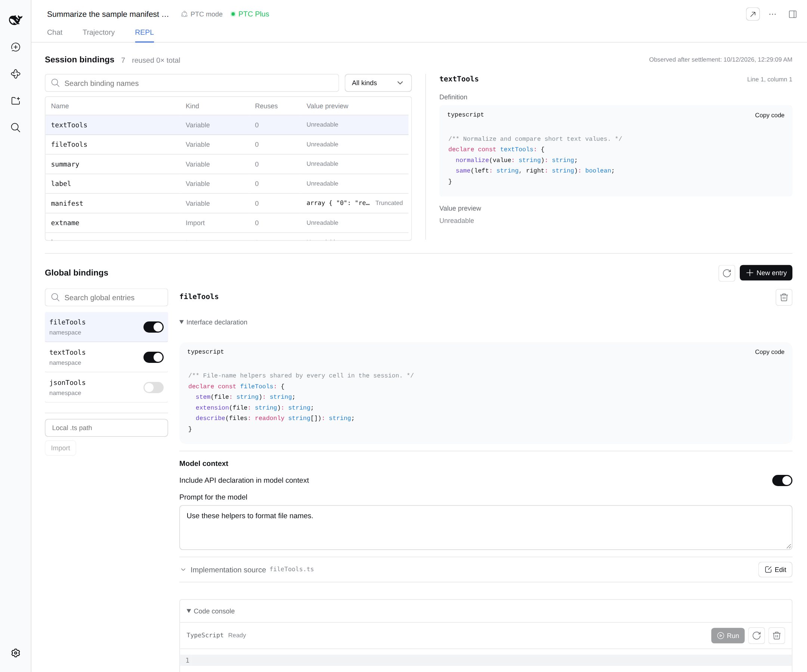
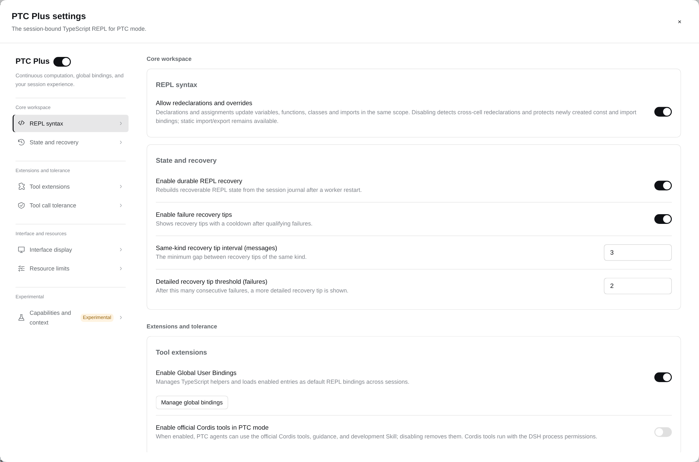

<p align="center">
  
</p>

<p align="center">
  <a href="README.md">简体中文</a> · <strong>English</strong>
</p>

<p align="center">
  <a href="https://github.com/deepseek-ai/deepseek-harness"></a>
  <a href="https://www.npmjs.com/package/dsh-ptc-plus"></a>
  <a href="LICENSE"></a>
</p>

<p align="center">
  <a href="https://awesome-dsh-plugin.com/"></a>
</p>

**Let the model keep computing and revise its work within a session, with less repeated setup and fewer avoidable tool-call errors.**

PTC Plus provides a stateful TypeScript computation environment for DSH's **PTC mode**. Built on a REPL, it keeps variables, functions, imports, and intermediate results available across tool calls. It extends declaration update rules and adapts module syntax, with call tolerance and code editing designed for models that repeatedly write and revise code.

- **Keep computing**: reuse data already loaded and processed in the session.
- **Revise directly**: update a variable or function under the same name; existing closures read the updated binding. Small changes can be sent as code deltas.
- **Avoid routine call failures**: use familiar module syntax, recover from identifiable call omissions, and receive correction suggestions for verifiable syntax errors.
- **Reuse common capabilities**: save functions as global bindings, provide their interfaces and usage notes to the model, and use them across sessions.

[Quick start](#quick-start) · [Feature overview](#feature-overview) · [Continuous computation](#continuous-computation-and-language-extensions) · [Editing and tolerance](#code-editing-and-call-tolerance) · [Global bindings](#global-bindings-reuse-functions-across-sessions) · [Interface and settings](#interface-and-settings) · [Values and recovery](#value-transfer-and-state-recovery) · [Development](#development)

## Quick start

Requires Node.js `^22.19.0 || >=24.0.0` and the latest available official DSH release:

```sh
dsh plugin --profile <profile> add dsh-ptc-plus
```

Replace `<profile>` with your profile name, restart DSH, and select **PTC mode** in the session. Continuous computation, call tolerance, and global bindings are on by default. To upgrade, run `dsh plugin --profile <profile> add dsh-ptc-plus@latest` and restart that Host; see the [installation guide](docs/installation.md) for other installation methods, Desktop, the local development launcher, and troubleshooting.

The plugin declares `engines.dsh: "*"` for the Host's compatibility preflight; public capability checks and packed tests against the latest official release verify compatibility.

The session shows a **REPL** tab, and wide screens show a **PTC Plus** header indicator. The sparkle button beside the composer opens the global binding menu, the session capability workbench, and **PTC Plus settings**; **Plugins → Installed → dsh-ptc-plus → Configure** in the sidebar is the same configuration.

## Feature overview

Default PTC mode starts every execution in a fresh environment: the previous call's variables are gone, and a change that depends on earlier results means resending the setup code. PTC Plus turns `run_code` into a session-bound TypeScript REPL and closes those gaps.

| Scenario | Default PTC mode | With PTC Plus |
| --- | --- | --- |
| Continue processing data | Each call starts fresh, so setup code must be sent again | Variables, functions, imports, and intermediate results stay in the session for the next call |
| Revise an existing name | No established binding can be updated, so the whole cell has to be resent | Revise variables, functions, classes, and import bindings under the same names; existing closures read updated bindings |
| Change a small part of the code | A one-line change means resending the complete source | Submit a delta through `edit_run_code`, then execute the complete revised cell |
| Use module syntax | Static `import` and `export` are invalid inside the function body | Write them directly in a cell; the plugin adapts the module syntax |
| Omit a call summary | Missing `run_code.description` fails validation | Supply a display summary automatically so otherwise valid code proceeds |
| Provider rejects malformed tool JSON | The whole turn ends with a provider error | A repairable call tail continues; anything else becomes a schema rejection result so the model can continue |
| Recover a misplaced top-level tool call | Undeclared top-level calls are rejected in PTC mode | Convert the call to `run_code` when the live tool definitions uniquely identify the target and validate its arguments |
| Locate a code error | Return the native error and stack | Map the error to the cell source; suggest an edit when a missing trailing delimiter has one verified correction |
| Work with the current directory | Execute in the directory resolved by the Host for the current call | Relative file operations and default child processes use the session's current directory when they run, and an in-cell `tools.working_directory({ cd })` applies to the rest of that cell; module imports keep the starting directory, and existing modules and import closures retain their source base |
| Find tools and parameters | Read through the tool interfaces already supplied to the model | Retrieve matching interfaces in one byte-budgeted `capabilities.search` response, or list and inspect members |
| Transfer data beyond plain JSON | JSON cannot fully represent `undefined`, BigInt, cycles, and similar values | Preserve supported special values and reference relationships for further computation and recovery |
| Inspect computation state | No reusable session variables remain after a call | View retained names, source definitions, reuse counts, and value previews in the REPL tab |
| Reuse functions across sessions | Save the code yourself and reload it in later calls | Save TypeScript global bindings and supply their interfaces and usage notes to the model |
| Author and test global bindings | No dedicated workbench for global bindings | Ask the model for a draft to review, or run unsaved source in the workbench |
| Continue after a restart | No computation state spans calls, so there is nothing to recover | Recover verifiable state from session records and report what cannot be recovered |

## Continuous computation and language extensions

The model executes the code below through `run_code`, and each call's code is a **cell**.

```ts
const amounts: number[] = [12, 8, 5]
function total() {
  return amounts.reduce((sum, value) => sum + value, 0)
}
return total() // 25
```

The next call revises the data without redefining `total`:

```ts
const amounts = amounts.filter(value => value >= 8)
return total() // 20
```

The default **stateful semantics** (`bindingUpdates: 'stateful'`) extend JavaScript/TypeScript binding rules for that continued revision:

- Variables, functions, classes, and import bindings in the same scope can be updated, including those declared with `const`, and same-name revisions also work inside one cell.
- Existing closures read the updated binding, a function value saved earlier is still the original function, and blocks, functions, and loop iterations keep their separate scopes.
- A failed initialization does not permanently reserve that name, and changes made before the failure are not rolled back.

Cells support TypeScript (including runtime `enum` and namespaces), top-level `await` / `return`, and static `import` / `export`; a static import takes effect before the whole cell body executes, and an assignment later in the body can override it. To detect name overwrites instead, disable **Allow redeclarations and overrides** and use the `protected` policy; protected runtime names such as `tools` can never be overwritten.

`run_code`, edited code, and the global binding workbench follow the same language policy, while explicit `eval`, `Function`, `node:vm`, and independent runtimes keep their own native boundaries. Scope, module interoperability, and historical session rules are in the [language reference](docs/runtime-reference.md#cell-semantics), and complete language rules, configuration fields, and diagnostics are in the [runtime reference](docs/runtime-reference.md).

## Code editing and call tolerance

The model can call `tools.edit_run_code` inside a new `run_code` cell to change the most recent editable cell of the current turn without resending its source:

```js
const receipt = await tools.edit_run_code({
  edits: [{ old_string: 'value >= 8', new_string: 'value >= 10' }]
})
return receipt
```

An `accepted: true, scheduled: true` receipt means the edit is scheduled: the entire target cell reruns after the outer cell finishes, and the next cell reads the revised value (`12` above). Reads later in the accepting cell still see the old state, earlier state changes are not rolled back, and a rerun of code that wrote files or called external services still needs to account for duplicate effects. Each regular-expression edit requires `pattern`, `flags`, `replacement`, and `expected_matches`; pass `""` explicitly when no flags are needed.

| Situation | PTC Plus behavior |
| --- | --- |
| `run_code` omits its outer `description` | Supply a display summary so code with otherwise valid arguments can execute |
| The model calls a native tool outside the PTC direct-tool list | Convert it to the corresponding `run_code` when current tool definitions uniquely identify the target and validate the arguments |
| Argument validation reports a missing `description` | Distinguish outer and nested tool arguments and provide correction guidance, saved as a complete message so session history remains loadable |
| Code fails to parse | Identify the source position; at EOF, suggest a target-bound edit if appending one or two closing delimiters has exactly one validated correction |

When an accepted edit cannot obtain a compute baseline before it runs, the receipt stays a receipt: the revision does not execute, publishes no new binding, and the outer cell keeps its own result, so a restart does not lose what that cell already saved as a durable checkpoint.

The first two behaviors are on by default and can be disabled in settings. Syntax suggestions never execute on their own, and they say nothing about whether the code matches the task's intent. A volatile state cannot be saved as a durable checkpoint, but a rejected save leaves the current variables usable; restore does not undo external effects or change global binding configuration.

## Project files and tool capabilities

The model can use Node.js directly to read files, process data, and run programs. Relative paths and child processes without an explicit `cwd` use the session's current directory when they run, so an in-cell `tools.working_directory({ cd })` applies to the rest of that cell and matches the Host tools. Module imports and `import.meta` keep the starting directory; loaded modules, escaped import closures, and captured `require` keep their original base, and `process.chdir` is unavailable inside a cell. File, network, and other external inputs stay usable in the live environment, but a restart is not guaranteed to recover them.

`capabilities.search()` finds and returns complete interfaces in one call, budgeted in bytes, with oversized entries kept complete and given an individual retrieval reference; `tree()`, `find()`, and `inspect()` remain available.

```ts
return capabilities.search({ query: 'read file content', budgetBytes: 8192 })
```

Search uses English/Chinese lexical matching, and a miss does not prove that a tool is unavailable. Discovery grants no additional authority, DSH still validates and schedules calls, and more usage notes are in [capability discovery](docs/runtime-reference.md#capability-discovery).

## Global bindings: reuse functions across sessions

Session variables serve the current task, and **global bindings** save common TypeScript functions for multiple sessions to load: after saving `textTools`, the model can call `textTools.clean(text)`. Create entries by hand, import `.ts` files, or ask the model:

```text
/binding new Create textTools to trim outer whitespace while preserving interior spaces
/binding edit <id> Add line-by-line trimming
```

The draft the model submits floats above the composer, and in the large dialog you read the complete source, interface, and model instructions before choosing **Save and enable**, **Save disabled**, or **Discard draft**; submitting a draft neither saves nor enables it. Enabled entries' interfaces and usage notes go to the model in new sessions, and a change made during a session takes effect on its next allowed request.

The workbench runs unsaved source and keeps temporary variables between executions; its computation state is separate from the model's session, file and network operations still have real effects, and entries can be managed without an active PTC session. See the [global binding guide](docs/user-bindings.en.md) for source format, interface generation, storage, and the full workflow.

## Interface and settings

The **REPL tab** lists the names kept in the session with their definitions, reuse counts, and value previews, and opens the global binding workbench. Hovering a collapsed execution card for 400 ms, or focusing it with the keyboard, shows an excerpt of its recorded source, result, and feature notices, and click, Enter/Space, or tap expands the full content and copies the code; “Preview execution content on hover” under Interface display turns this off.



The settings window and the sidebar plugin configuration page are the same configuration, grouped like this:

| Functional module | Group | What you can adjust |
| --- | --- | --- |
| Plugin switch | PTC Plus title switch | Enable or disable PTC Plus |
| Core workspace | REPL syntax | Allow same-name revisions or choose name protection |
| Core workspace | State and recovery | Restart recovery, official REPL ownership, contextual tips with their frequency, and the unmeasured-cell reclaim threshold |
| Extensions and tolerance | Tool extensions | Global bindings and their management entry, official Cordis tool integration |
| Extensions and tolerance | Tool call tolerance | Missing call summaries and identifiable misplaced native-tool calls |
| Interface and resources | Interface display | Enhanced tool cards, the REPL tab, and the sparkle shortcut |
| Interface and resources | Resource limits | Execution time, memory, output, sampling, reclamation, and startup limits |
| Experimental | Capabilities and context | Experimental capability management (off by default), independent statistics, common baseline, individual choices, presentation budgets, and prompt text |

Everyday computation features are on by default, and **Cordis development tools are off by default** so they can be enabled when inspecting or developing DSH plugins; see the [integration notes](docs/adr/0020-optional-cordis-tools-in-ptc-mode.md).

Capabilities and context is an experimental group, off by default. It selects availability and disclosure for Skills, tools, and MCP capabilities by category, source, or item, and it also covers Initial prompt, Prompt recovery, Output excerpts, and Usage statistics; the switch beside its title pauses the whole group while keeping every choice, and changes apply to new sessions or to a session after an explicit refresh. The sparkle menu also opens the session capability workbench, which views and adjusts the current session's capabilities by category, source, and state: edits live in one draft that you can apply to this session only or save as the global default. See the [configuration reference](docs/runtime-reference.md#configuration) for fields, defaults, and full limits.

The **Prompt text** tab lists the fixed text the plugin writes for the model: each row names its channel, presence condition, byte count, and read-only reason, and the totals line reports measured bytes, unmeasured slots, and dynamic slots separately. Editable rows are counted per slot and saving writes the configuration; a channel that is not connected yet says so instead of reporting zero bytes as if measured; protocol text, sentences generated from configuration or runtime facts, and the binding notes you wrote yourself stay read-only.

Before a new session starts, capability and global binding changes only update its initial configuration; no change notices are sent or queued. The first request uses the resulting configuration.

The host execution provider must use TypeScript; changing it to another language during a reload withdraws the plugin and reports a diagnostic, and switching back re-enables it.

With DSH's official `executionMode: persistent-in-memory` enabled, **Prioritize the official REPL mode** under State and recovery chooses who owns the PTC session: disabled by default, so PTC Plus owns `run_code`; enabled, the official runtime owns execution and PTC Plus leaves execution, REPL state semantics, and observation to it. The setting has no effect while the official mode is off. Ownership changes take effect immediately and leaving plugin execution disposes its in-memory environment. Official in-memory state follows DSH's Agent/provider lifecycle; changing priority does not guarantee clearing it. Official-mode calls stay outside the plugin's records, so they never count as recoverable state after switching back to the plugin.



## Value transfer and state recovery

Stopping a background subagent preserves the parent session's REPL state, so calls triggered by its notification can continue using the parent's variables. If the parent session itself is disposed, later calls follow the recovery rules below.

Within the supported range of the plugin's graph IPC, program arguments, results, and recovery records keep `undefined`, BigInt, `NaN`, infinities, sparse arrays, cycles, and shared references, and supported values can be returned directly without writing `JSON.stringify` yourself (it drops object fields containing `undefined`, turns `NaN` and infinities into `null` and `-0` into `0`, and rejects BigInt). Functions, Promises, class instances, Date, Map, and Set are outside that range, and native `tools.*` JSON argument and result contracts do not change; see the [value contract](docs/value-wire.md).

Session state is not permanent memory: after a restart, a runtime reset, or context compaction, only state verifiable from session records whose provenance remains in the model's context is retained, and everything else is discarded with a diagnostic, continuing in an empty environment when necessary. Missing or damaged session records produce an explicit error instead of being treated as a successfully recovered empty session. Recovery neither redispatches recorded native-tool calls nor reverses historical external effects; see the [runtime reference](docs/runtime-reference.md) for its evidence and limits.

## Boundaries

- **Execution permissions**: primarily designed for `danger-full-access`. Code can reach Node.js and the operating system directly, and the plugin adds no security sandbox; native-tool permissions, approvals, cancellation, and sandbox policy stay with DSH.
- **Failures and reruns**: a failed execution does not mean earlier statements had no effect. Process isolation, editing, and recovery do not make an external operation safe to repeat, and a timeout or an output overflow can release the computation environment.
- **Errors and cost**: language adaptation and call tolerance do not guarantee that every program runs, and actual call counts and token usage depend on the task and model; the [evaluation notes](docs/evaluation.md#recorded-paired-observation) record one comparison and its limits.

PTC Plus is a community plugin, with no affiliation with or endorsement from DeepSeek or DSH.

## Development

Development happens in the repository root: `npm ci` installs dependencies and `npm run build` regenerates `client.cjs` and the compiler artifacts. Focused tests require an explicit selection:

```sh
npm run test:backend:focus -- --file test/<owner>.test.js --test-name-pattern="<case>"
npm run test:client:focus -- "<test name pattern>"
```

Before delivery, pick the check through [change classification](docs/verification.md#change-classification): documentation-only changes run `npm run verify:docs`, everything else runs `npm run check`, and both are followed by the [review procedure](docs/review-procedure.md). Architecture and the data plane are in [architecture and development](docs/architecture.md), the [documentation index](docs/README.md) lists everything, and installation and publishing are covered by the [installation guide](docs/installation.md) and the [publishing procedure](docs/publishing.md).

[MIT License](LICENSE)
