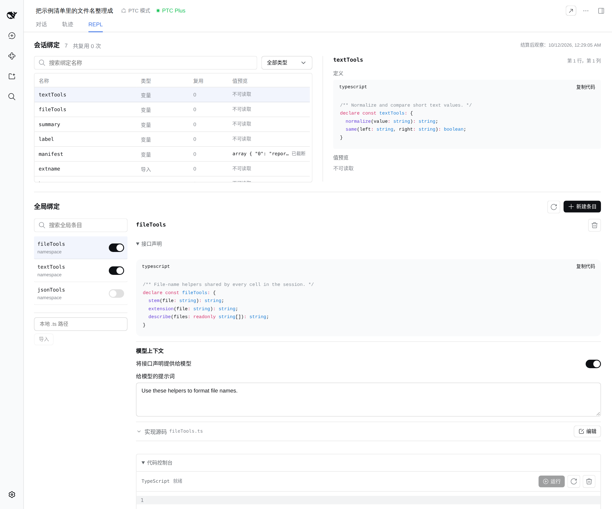
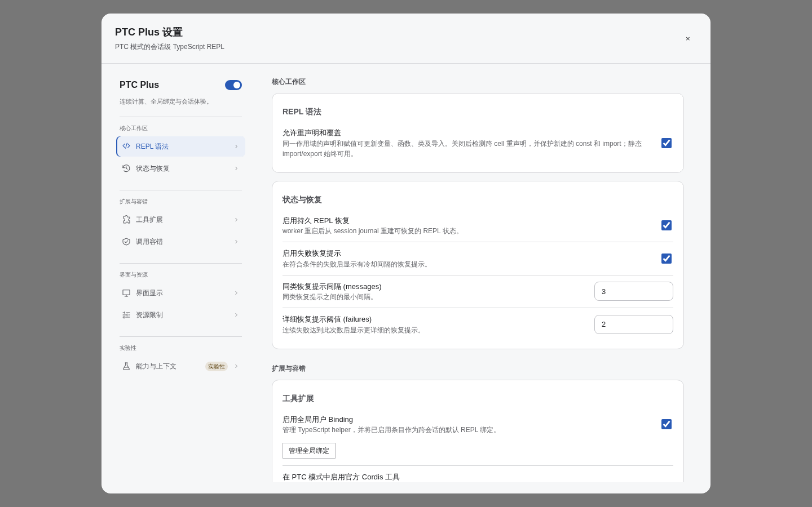

<p align="center">
  
</p>

<p align="center">
  <strong>简体中文</strong> · <a href="README.en.md">English</a>
</p>

<p align="center">
  <a href="https://github.com/deepseek-ai/deepseek-harness"></a>
  <a href="https://www.npmjs.com/package/dsh-ptc-plus"></a>
  <a href="LICENSE"></a>
</p>

<p align="center">
  <a href="https://awesome-dsh-plugin.com/zh/"></a>
</p>

**让模型在同一会话中持续计算、直接修订，减少重复工作和可避免的工具调用错误。**

PTC Plus 为 DSH 的 **PTC 模式**提供有状态的 TypeScript 计算环境。它基于 REPL，让变量、函数、导入和中间结果跨工具调用复用；针对模型连续编写和修改代码的需要，扩展声明更新规则，并提供模块语法适配、调用容错和代码编辑能力。

- **接着算**：读取和整理过的数据留在会话里，下一次调用直接继续。
- **直接改**：同名修订变量或函数，已有闭包读取更新后的绑定；小改动可以只发送代码差异。
- **少些调用错误**：适配常用模块语法，处理可准确识别的调用遗漏，并为可验证的语法错误提供修正建议。
- **复用常用能力**：把常用函数保存为全局绑定，向模型提供接口与使用提示，在多个会话中使用。

[快速开始](#快速开始) · [功能概览](#功能概览) · [连续计算](#连续计算与语言扩展) · [代码编辑与容错](#代码编辑与调用容错) · [全局绑定](#全局绑定跨会话复用常用函数) · [界面与设置](#界面与设置) · [状态与恢复](#值传递与状态恢复) · [开发](#开发)

## 快速开始

需要 Node.js `^22.19.0 || >=24.0.0` 和最新可用的官方 DSH：

```sh
dsh plugin --profile <profile> add dsh-ptc-plus
```

把 `<profile>` 换成实际 profile 名称，重启 DSH，在会话中选择 **PTC 模式**。连续计算、调用容错和全局绑定默认开启；升级用 `dsh plugin --profile <profile> add dsh-ptc-plus@latest` 再重启宿主，其他安装方式、Desktop、本地开发启动器和故障排查见[安装指南](docs/installation.md)。

插件通过 `engines.dsh: "*"` 接入宿主兼容性预检，按最新官方发行版的公共能力检查与打包测试验证兼容性。

界面默认显示会话里的 **REPL** 页签，宽屏顶部还有 **PTC Plus** 标志。输入框旁的星光按钮打开全局绑定菜单、会话能力工作台和 **PTC Plus 设置**，侧边栏的 **插件 → 已安装 → dsh-ptc-plus → 配置** 是同一套设置。

## 功能概览

默认 PTC 模式的每次调用都从新环境开始：上次的变量已经不在了，想改动依赖前面的结果就只能重发准备代码。PTC Plus 把 `run_code` 变成会话级的 TypeScript REPL，补上这些差距。

| 场景 | 默认 PTC 模式 | 使用 PTC Plus |
| --- | --- | --- |
| 接着上一次处理数据 | 每次从新环境开始，准备代码要重新发送 | 变量、函数、导入和中间结果留在会话里，下一次调用直接继续 |
| 修订已有的名称 | 没有已建立的绑定可更新，只能重发整段代码 | 同名修订变量、函数、类和导入绑定，已有闭包读取更新后的值 |
| 只改一小段代码 | 改动一行也要重新发送整段源码 | `edit_run_code` 只提交差异，再执行修改后的完整代码 |
| 使用模块语法 | 函数体里不能直接写静态 `import` / `export` | 在 cell 中直接写，插件自动适配模块语法 |
| 调用漏填摘要 | 缺少 `run_code.description` 时校验失败 | 自动补充显示摘要，其余参数合法的代码继续执行 |
| 提供方拒绝畸形工具 JSON | 整个 turn 以 provider 错误终止 | 可修复的调用尾部继续执行，其余转为 schema 拒绝结果，模型继续下一步 |
| 误发顶层工具调用 | PTC 模式下未声明的顶层调用被拒绝 | 当前工具定义能唯一确认目标且参数合法时，转为对应的 `run_code` |
| 定位代码错误 | 只返回原生错误与堆栈 | 对应到 cell 源码位置；末尾缺少闭合符且修正可唯一验证时给出编辑建议 |
| 访问当前目录 | 按宿主为当前调用解析的目录执行 | 相对文件操作和默认子进程按执行时的会话当前目录解析，格内 `tools.working_directory({ cd })` 立即作用于本格剩余语句；模块导入保持进入目录，旧模块和导入闭包保留原来源 |
| 查找工具和参数 | 只能翻已经提供给模型的工具说明 | 用 `capabilities.search` 一次取得匹配接口，按字节限制响应；也可列目录或单项检查 |
| 传递 JSON 不易表达的数据 | JSON 无法完整表达 `undefined`、BigInt、循环引用等 | 在支持的值范围内保留特殊值和引用关系，供后续计算与恢复 |
| 查看当前计算状态 | 执行结束后没有可继续使用的会话变量可查 | REPL 页签展示保留的名称、定义来源、复用次数和值预览 |
| 跨会话使用常用函数 | 自己保存代码，并在后续调用中重新加载 | 全局绑定保存 TypeScript 源码，并向模型提供接口与使用提示 |
| 编写和测试全局绑定 | 没有全局绑定的专用工作台 | 让模型生成待审阅草稿，或在工作台试运行未保存的源码 |
| 重启后继续工作 | 没有跨调用的计算状态可供恢复 | 从会话记录恢复可验证的状态，无法恢复的部分明确提示 |

## 连续计算与语言扩展

以下代码由模型通过 `run_code` 执行，每次调用的代码称为一个 **cell**。

```ts
const amounts: number[] = [12, 8, 5]
function total() {
  return amounts.reduce((sum, value) => sum + value, 0)
}
return total() // 25
```

下一次直接修订数据，`total` 不用重新定义：

```ts
const amounts = amounts.filter(value => value >= 8)
return total() // 20
```

默认的 **有状态语义**（`bindingUpdates: 'stateful'`）为此扩展了 JavaScript/TypeScript 的绑定规则：

- 同一作用域里的变量、函数、类和导入绑定都能更新，包括 `const` 声明的；同一个 cell 内也允许同名修订。
- 已有闭包读到更新后的绑定，提前保存的函数值仍是原来的函数；不同块、函数和循环迭代的作用域照常区分。
- 声明初始化失败不会永久占住这个名称，失败前已经生效的修改也不会回滚。

cell 支持 TypeScript（含运行时 `enum` 和 `namespace`）、顶层 `await` / `return` 和静态 `import` / `export`；静态导入在整个 cell 正文执行前生效，正文里的赋值随后可以覆盖它。想检测名称覆盖，可以在设置里关掉“允许重声明和覆盖”改用 `protected` 策略；`tools` 这类受保护的运行时名称任何时候都不能覆盖。

`run_code`、编辑后的代码和全局绑定工作台采用同一套语言策略；显式 `eval`、`Function`、`node:vm` 或独立运行时仍受各自的原生边界约束。作用域、模块互操作和历史会话规则见[语言参考](docs/runtime-reference.md#cell-semantics)，完整的语言规则、配置字段与诊断见[运行时参考](docs/runtime-reference.md)。

## 代码编辑与调用容错

模型可以在新的 `run_code` cell 内调用 `tools.edit_run_code`，修改当前轮最近的可编辑 cell，不必重发整段源码：

```js
const receipt = await tools.edit_run_code({
  edits: [{ old_string: 'value >= 8', new_string: 'value >= 10' }]
})
return receipt
```

收据里 `accepted: true, scheduled: true` 表示编辑已经安排：外层 cell 结束后才重新执行整个目标 cell，下一次 cell 读到的是修订后的值（上例是 `12`）。同一次调用里再读仍是旧状态，已经发生的状态修改不会回滚，写过文件或调用过外部服务的代码重跑时要考虑重复效果。正则编辑的每项必须给出 `pattern`、`flags`、`replacement`、`expected_matches`，不需要标志时显式传 `""`。

| 情况 | PTC Plus 的处理 |
| --- | --- |
| `run_code` 漏填外层 `description` | 补充显示摘要，让其余参数合法的代码继续执行 |
| 模型误发 PTC 直接工具列表之外的原生工具调用 | 当前工具定义能唯一确认目标且参数合法时，转为对应的 `run_code` |
| 参数校验报告缺少 `description` | 区分外层与嵌套工具参数并给出修正提示；提示以完整消息保存，保持会话历史可加载 |
| 代码解析失败 | 标出源码位置；若错误在末尾，且追加一到两个闭合符只有一种通过验证的修正，给出绑定原调用的编辑建议 |

被接受的编辑若在真正执行前因为没有取得计算基线而未能运行，收据仍然是收据：修订不执行、不产生新变量，外层 cell 自己的结果照常保存，重启恢复时也不会再因为这次编辑而连带丢掉它已保存为 durable 检查点的状态。

设置里的“编辑时替换原单元格”（`editRewritesHistory`，默认关闭）决定日志重建环境时怎么看待这次编辑。关闭时保持追加语义：被编辑的单元格和修订都留在环境里，修订只是覆盖了它重新声明的名字。打开后被编辑的单元格仍然留在会话日志里，但不再参与环境重建，改由修订代替它；修订不再声明的名字按“被取代”报告（`PTC-R007`），而不是按“丢失”报告。日志能证明的具体名字会被点名，证明不了时只陈述取代关系。

前两项默认开启，可以在设置里关掉。语法建议不会自动执行，也不代表代码符合任务意图。volatile 状态存不成 durable 检查点，但保存被拒绝后当前变量还能接着用；恢复不撤销外部效果，也不改全局绑定配置。

## 项目文件与工具能力

模型可以直接用 Node.js 读文件、处理数据、跑程序。相对路径和没指定 `cwd` 的子进程按执行时的会话当前目录解析：格内调用 `tools.working_directory({ cd })` 后，本格剩余操作就用新目录，与宿主工具同一基准。模块导入和 `import.meta` 仍按进入目录，已加载模块、旧导入闭包和已捕获的 `require` 保留原来源；`process.chdir` 在 cell 内不可用。文件、网络等外部输入在当前环境里可以继续用，但不保证跨重启还能恢复。

`capabilities.search()` 一次查找并返回完整接口，预算按字节计算，过长条目保持完整并给出单项读取指针；原有的 `tree()`、`find()`、`inspect()` 仍可用。

```ts
return capabilities.search({ query: 'read file content', budgetBytes: 8192 })
```

搜索按中英文词法匹配，没匹配到不代表工具不存在。发现工具不会增加权限，实际调用仍由 DSH 校验和调度，更多用法见[能力发现](docs/runtime-reference.md#capability-discovery)。

## 全局绑定：跨会话复用常用函数

会话变量服务于当前任务，**全局绑定**把常用 TypeScript 函数保存下来供多个会话加载：保存 `textTools` 之后，模型就能调用 `textTools.clean(text)`。你可以手动创建、导入 `.ts` 文件，也可以让模型帮忙：

```text
/binding new 创建 textTools，去掉文本首尾空白并保留内部空格
/binding edit <id> 增加逐行清理功能
```

模型提交的草稿浮在输入框上方，你在大窗口里看完整源码、接口和给模型的提示词，再选 **保存并启用**、**保存为停用** 或 **丢弃草稿**；提交草稿本身不会保存或启用绑定。已启用条目的接口和使用提示会提供给新会话中的模型，中途修改在现有会话的下一次允许请求中生效。

工作台可以运行尚未保存的源码，并在连续执行之间保留临时变量；它的计算状态和模型会话分开，文件和网络操作仍会产生真实效果，没有 PTC 会话时也能管理条目。源码格式、接口生成、保存位置和完整流程见[全局绑定指南](docs/user-bindings.md)。

## 界面与设置

**REPL 页签**列出会话里保留的名称、定义来源、复用次数和值预览，也能打开全局绑定工作台。执行卡片收起后，鼠标停留 400ms 或键盘聚焦会弹出一份源码、结果和功能标记的摘录，点击或按 Enter／空格展开完整内容并复制代码；不需要时可以在设置的“界面显示”里关掉“悬停预览执行内容”。



设置窗口和侧边栏的插件配置页是同一套配置，分组如下：

| 功能模块 | 分组 | 可以调整的内容 |
| --- | --- | --- |
| 插件开关 | PTC Plus 标题总开关 | 启用或停用 PTC Plus |
| 核心工作区 | REPL 语法 | 允许同名修订或选择名称保护 |
| 核心工作区 | 状态与恢复 | 重启恢复、官方 REPL 模式归属、上下文提示及其频率、未测量 cell 回收阈值 |
| 扩展与容错 | 工具扩展 | 全局绑定及其管理入口、官方 Cordis 工具集成 |
| 扩展与容错 | 调用容错 | 缺失调用摘要、可识别的错位原生工具调用 |
| 界面与资源 | 界面显示 | 增强工具卡片、REPL 页签和星光快捷入口 |
| 界面与资源 | 资源限制 | 执行时间、内存、输出、采样、回收与启动上限 |
| 实验性 | 能力与上下文 | 实验性能力管理（默认关闭）、独立统计、常用集、单项选择、展示预算和提示文本 |

新会话尚未开始时，调整能力或全局绑定只更新初始配置，不发送或排队发送变更说明；首轮使用调整后的配置。

面向日常计算的功能默认开启，**Cordis 开发工具默认关闭**，要检查或开发 DSH 插件时再打开，详见[集成说明](docs/adr/0020-optional-cordis-tools-in-ptc-mode.md)。

“能力与上下文”是实验性设置，默认关闭。打开后可以按类别、来源和单项选择 Skills、Tools 和 MCP 能力的启停与说明方式，初始提示、提示恢复、输出节选和使用统计也在这里；标题旁的总开关一次暂停整组并保留原有选择，改动对新会话或明确刷新后的会话生效。星光菜单里还有一个会话能力工作台，用来按类别、来源和状态查看、调整当前会话的能力，能力改动先放进草稿，可以只写进本会话，也可以保存成全局默认；同一工作台的绑定组不走进草稿，点击某一行的“本会话使用/本会话不使用”立即提交人类输入的同一条 `/binding use|skip <id>` 命令，改的是本会话对该全局条目的取用。字段、默认值和完整限制见[配置参考](docs/runtime-reference.md#configuration)。

**提示文本**页签把插件写给模型的固定文本列成清单：每行标注所属通道、存在条件、字节数与只读原因，合计行分别给出已测字节、未测槽和动态槽。可编辑项按槽位计字节，改完保存即写入配置；通道尚未接通时如实显示“通道未接通”，不以 0 字节冒充已测量；协议文本、由配置或运行事实生成的句子，以及你自己写给模型的绑定说明只读展示。

宿主执行 provider 必须使用 TypeScript；热重载换成别的语言时插件会撤出并报出诊断，换回来就重新启用。

当官方运行时按状态所有者保留程序环境时，可以在“状态与恢复”里用**官方 REPL 模式优先**选择谁接管 PTC 会话：默认关闭，`run_code` 由 PTC Plus 接管；开启后由官方运行时接管，PTC Plus 让出执行、REPL 状态语义与观察。判断依据是运行时自己的声明（`retainsState`；更早的运行时通过 `repl` 源码形式表达同一件事），不是某个执行模式名或版本号，无状态运行时上该设置不生效。切换立即生效，离开插件执行时会释放插件的内存环境；官方内存状态由 DSH 的 Agent/provider 生命周期管理，切换优先设置不保证清空它。官方执行期间的调用不进入插件记录，切回插件后不会当作可恢复状态。



## 值传递与状态恢复

在插件 graph IPC 支持的值范围内，程序参数、结果和恢复记录能保留 `undefined`、BigInt、`NaN`、无穷大、稀疏数组、循环引用和共享引用关系，支持的值直接返回即可，不必自己写 `JSON.stringify`（它会丢掉对象里的 `undefined`，把 `NaN` 和无穷大变成 `null`、把 `-0` 变成 `0`，还会拒绝 BigInt）。函数、Promise、类实例、Date、Map、Set 不在这个范围内，原生 `tools.*` 的 JSON 参数与结果契约也不受影响，详见[值契约](docs/value-wire.md)。

会话状态不是永久内存：重启、执行环境重置或上下文压缩后，只保留能从会话记录验证、且来源仍在模型上下文中的状态，其余会被丢弃并给出提示，必要时从空环境继续当前计算。会话记录本身缺失或损坏时会明确报错，不会被当作成功恢复的空会话。恢复不会重新派发已记录的原生工具调用，也不会撤销历史外部效果，依据和限制见[运行时参考](docs/runtime-reference.md)。

停止后台子代理不会清空父会话的 REPL 状态；通知触发的后续调用可以继续使用父会话的变量。父会话自身释放后，后续调用仍按上述恢复规则继续计算。

## 使用边界

- **执行权限**：主要面向 `danger-full-access`。代码可以直接访问 Node.js 和操作系统，插件不额外提供安全沙箱；原生工具权限、审批、取消和沙箱策略仍归 DSH。
- **失败与重跑**：代码执行失败不代表之前的语句没生效。进程隔离、编辑和恢复都不保证外部操作可以安全重复，超时或输出超限也可能释放计算环境。
- **错误与开销**：语言适配和调用容错不保证所有代码都能跑通，实际调用次数和 token 用量取决于任务和模型，已有对照观察及限制见[评测说明](docs/evaluation.md#recorded-paired-observation)。

PTC Plus 是社区插件，与 DeepSeek 或 DSH 无隶属或背书关系。

## 开发

开发在仓库根目录进行：`npm ci` 安装依赖，`npm run build` 重新生成 `client.cjs` 和 compiler 产物。聚焦测试必须指定用例：

```sh
npm run test:backend:focus -- --file test/<owner>.test.js --test-name-pattern="<case>"
npm run test:client:focus -- "<test name pattern>"
```

交付前按[变更分类](docs/verification.md#change-classification)选检查：只改文档跑 `npm run verify:docs`，其他改动跑 `npm run check`，然后走[评审流程](docs/review-procedure.md)。架构和数据面见[架构与开发](docs/architecture.md)，全部文档见[文档索引](docs/README.md)，安装与发布见[安装指南](docs/installation.md)和[发布流程](docs/publishing.md)。

[MIT License](LICENSE)
